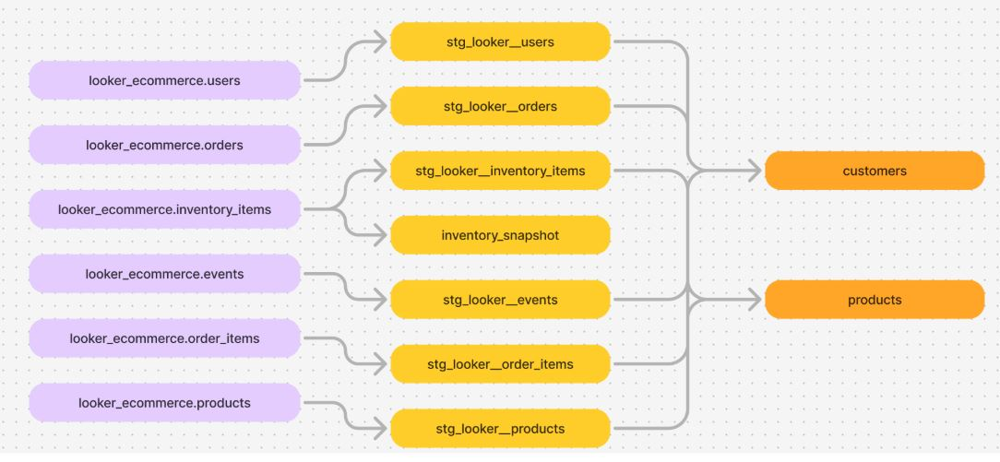

# E-Commerce Data Models with dbt

A case study demonstrating how to build a modern analytics layer for an e-commerce business using dbt. It models customers, orders, products, payments, and sessions into trusted, testable warehouse tables.

## Goals
- Centralize raw e-commerce data into dimensional models
- Create reliable, testable metrics for revenue, AOV, retention, and funnels
- Enable analytics and BI (Looker/PowerBI/Tableau) on clean, governed tables

## Warehouse & Adapter
- Warehouse: SQL Server (2017+)
- dbt adapter: dbt-sqlserver
- ODBC driver: 17

## Project Structure
- models/: staging + marts
  - staging/: source-normalization per domain (customers, orders, products, events)
  - marts/: dimensional models (dim_customer, dim_product) and facts (fct_orders, fct_payments)
- macros/: shared transformations (surrogate keys, null handling)
- seeds/: reference data (statuses, mappings)
- tests/: data tests and schema YAML

## Data Architecture
- Sources: raw operational tables (OLTP or ingestion layer)
- Staging: column standardization, typing, deduplication, soft-deletes handling
- Dimensions: slowly changing attributes on customers/products
- Facts: grain-aligned tables (orders at order_id, payments at payment_id, events at session-event_id)
- Snapshots: customer attribute changes over time (optional)

## Key Models
- stg_orders: canonical order fields, currency normalization
- stg_order_items: item-level line details
- stg_payments: payment attempts, status mapping
- stg_customers: identifiers, email normalization
- dim_customer: customer profile + lifecycle states
- dim_product: SKU attributes, category hierarchy
- fct_orders: revenue, discounts, tax, shipping, order status
- fct_payments: captured/refunded amounts, payment method
- fct_sessions: session funnel metrics (views → add_to_cart → checkout → purchase)

## Metrics Examples
- Revenue: sum(fct_orders.total_amount)
- AOV: revenue / count(distinct order_id)
- Conversion rate: purchases / sessions
- Repeat purchase rate: customers with 2+ orders / total customers
- Refund rate: refunded_amount / captured_amount

## Prerequisites
- Python 3.9+
- dbt-core==1.10.x
- dbt-sqlserver==1.9.x
- Microsoft ODBC Driver 17 or higher for SQL Server installed

## Setup
1. Install dependencies:
   - Windows terminal:
     - python -m venv .venv
     - .\.venv\Scripts\activate
     - pip install -r requirements.txt
2. Configure profiles.yml (Windows):
   - Location: %USERPROFILE%\.dbt\profiles.yml
   - Example:
     dbt_project:
       target: dev
       outputs:
         dev:
           type: sqlserver
           driver: ODBC Driver 17 for SQL Server
           server: YOUR_HOST or HOST\INSTANCE
           port: 1433
           database: YOUR_DB
           schema: ecommerce
           windows_login: true
           encrypt: true
           trust_cert: true

3. Validate connection:
   - dbt debug

## Usage
- Build all models:
  - dbt build
- Run only marts:
  - dbt run --select marts
- Execute tests:
  - dbt test
- Run a specific model:
  - dbt run --select fct_orders

## Source Configuration
Define sources in models/src_sources.yml:
- database, schema, and source freshness (e.g., loaded_at_field)
- Example sources: raw_orders, raw_order_items, raw_payments, raw_customers, raw_events

## Testing & Governance
- Schema tests: unique, not_null on keys and business-critical fields
- Data tests: referential integrity between facts and dims
- Freshness tests: ensure ingestion is timely
- Documentation: dbt docs generate && dbt docs serve

## CI Recommendations
- Run dbt build on PR branches against a dev schema
- Enforce dbt test passing before merge
- Use artifacts (manifest.json) for lineage-aware impact analysis

## Troubleshooting
- profile.yml misconfigurations: verify server, database, schema
- Encryption issues: set encrypt: true and trust_cert: true for local/dev
- Permissions: ensure CREATE TABLE/SCHEMA rights for your target schema
